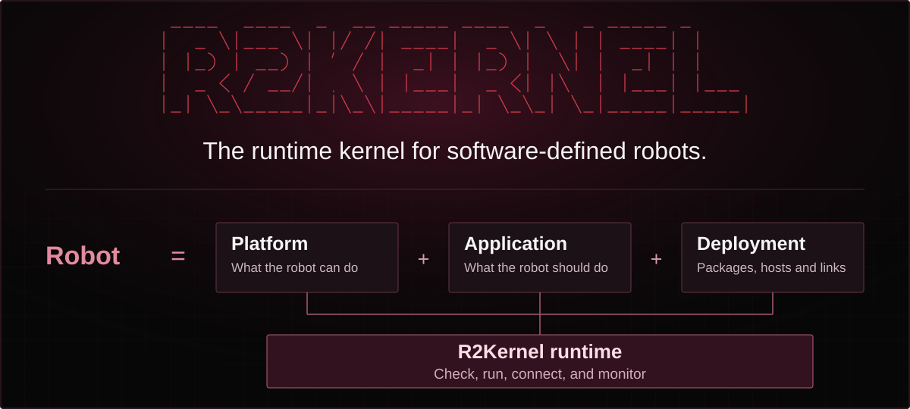

<div align="center">

[](https://github.com/r2kernel/r2kernel) [](https://github.com/r2kernel/r2kernel/releases)

</div>

<picture>
  <source media="(max-width: 600px)" srcset="https://raw.githubusercontent.com/r2kernel/.github/main/profile/assets/hero-compact.svg">
  
</picture>

<div align="center">

**Bring robot software together. Run it as one system.**

R2Kernel provides a common runtime for launching, connecting, and monitoring robot software.

Use it on a single host or across multiple hosts within one robot.

[Get started](https://docs.r2kernel.org/getting-started/installation/) · [Documentation](https://docs.r2kernel.org/) · [SDK](https://github.com/r2kernel/sdk)

</div>

---

## Why R2Kernel?

A robot is a complex system. It combines sensors, actuators, computers, and software. These parts have different requirements, and they must work together.

As the system grows and changes, its connections and settings become harder to manage. Important information may be spread across code, configuration files, and deployment settings. This makes the system harder to understand, reproduce, and maintain.

We built R2Kernel to give robot software a common runtime platform. Contracts describe how components connect. The runtime manages startup, checks resources, and shows what is running. This helps developers maintain and improve the system over time.

[R2Kernel in three minutes](https://docs.r2kernel.org/overview/r2kernel-in-3-minutes/) · [Design philosophy](https://docs.r2kernel.org/overview/design-philosophy/) · [Architecture](https://docs.r2kernel.org/architecture/subsystems-and-contracts/)

## Get started

### Check platform support

The installation guide covers **Ubuntu and Debian**. Linux packages are available for **x86_64** and **aarch64**.

The aarch64 packages have not been qualified on ARM hardware. R2Kernel has not been qualified for hard real-time use. Read [Support and Compatibility](https://docs.r2kernel.org/reference/support-and-compatibility/) for the current limits.

### Install the current stable release

Before installing, read the [installation requirements](https://docs.r2kernel.org/getting-started/installation/) and the [license and download notice](https://docs.r2kernel.org/reference/distribution-and-licensing/).

Run this command:

```sh
curl --proto '=https' --tlsv1.2 -fsSL https://download.r2kernel.org/install.sh | sh
```

This command installs the release currently selected by the **stable** channel. The selected version can change when a new stable release becomes available.

The installer will ask you to accept the runtime license. It may also ask for administrator access.

After installation, [run your first application](https://docs.r2kernel.org/getting-started/quickstart/).

### Install a specific version

To select a fixed release, follow the version-selection instructions in the [Installation Reference](https://docs.r2kernel.org/reference/installation-reference/).

Choose a specific version when you need to repeat the same setup. Record that version with your deployment.

The Installation Reference also explains how to choose another release channel or change the installation location.

## Build and operate

| What you want to do | Start here |
| --- | --- |
| Build a subsystem | [Developer guide](https://docs.r2kernel.org/develop/developer-guide/) · [SDK source](https://github.com/r2kernel/sdk) |
| Run and manage robot software | [Operations guide](https://docs.r2kernel.org/operate/operator-overview/) |
| Find release notes and downloads | [Releases](https://github.com/r2kernel/r2kernel/releases) |
| Improve the documentation | [Documentation source](https://github.com/r2kernel/docs) |

## Questions, bugs, and ideas

[Open an issue](https://github.com/r2kernel/r2kernel/issues) to ask a question, report a bug, suggest a feature, or share feedback on the SDK or documentation.

Include your R2Kernel version and the component involved. For a bug report, explain what you expected, what happened, and how to reproduce the problem.

<details>
<summary>Report a security issue privately</summary>

Report possible security issues through the [LibreRobotics contact form](https://librerobotics.org/#contact).

Keep security details out of public issues, pull requests, and discussions while the issue is being addressed.

</details>

## Licensing and use

The R2Kernel runtime is provided as binaries under a proprietary license.

The public SDKs, specifications, tutorials, and documentation use **Apache-2.0**. Third-party components have their own license terms and notices.

Read [Distribution and Licensing](https://docs.r2kernel.org/reference/distribution-and-licensing/) for the terms that apply to each part of the project.

<details>
<summary>Download privacy</summary>

The official download service may record:

- Installation session ID, client IP address, and user agent.
- The requested release, platform, architecture, and artifact name.
- Response status and the stored size of the requested artifact.

The stored size is the size of the file on the server. It does not show how many bytes the client received.

These records help us deliver downloads, find delivery problems, investigate abuse, and keep the service secure and reliable.

Read the [download notice](https://docs.r2kernel.org/reference/distribution-and-licensing/) and the notices included with your installation for more information.

</details>

<details>
<summary>Release information</summary>

Each versioned release includes files that identify its contents:

- [**`install.sh`**](https://github.com/r2kernel/r2kernel/releases) included with each release is pinned to that version.
- [**`release.json`**](https://github.com/r2kernel/r2kernel/blob/main/release.json) describes the release.
- [**`r2kernel.repos`**](https://github.com/r2kernel/r2kernel/blob/main/r2kernel.repos) records the matching SDK and documentation revisions.

The command in **Install the current stable release** follows the stable channel. To select a fixed version, follow **Install a specific version**.

</details>
